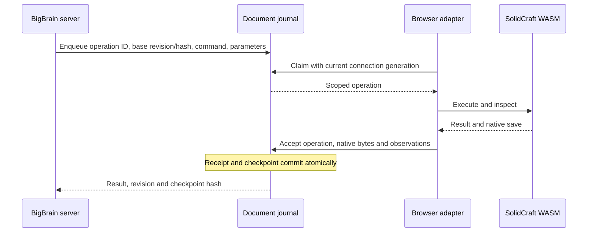

# Browser CAD execution bridge

## Phase 2 result

The BigBrain server queues revision-scoped construction commands for the pinned
SolidCraft 0.28.0 browser runtime. The adapter discovers 553 command IDs and their
parameter summaries on the qualified build. Native saves, operation receipts and
checkpoint identities persist in a per-document SQLite journal.

The browser qualification passed seven stages on a disposable copy of the retained
plate. It changed the width, recovered interrupted work, saved a manual change and
constructed a separate named solid through the serial command pump. This campaign
used deterministic commands and consumed zero model calls.

## Exchange and persistence



Each HTTP exchange carries the document and conversation identities. Execution
adds the operation ID, base revision/hash and connection generation. Reusing an
operation ID with changed content is rejected. A repeated accepted request returns
its original receipt. Each accepted checkpoint remains addressable by revision.

A reconnect replaces the generation, restores the last accepted native document
and requeues an uncertain operation. Responses from the previous generation are
rejected. Re-execution starts from the accepted bytes; the visible document gains
one accepted revision. This permits repeated execution of pure CAD construction
commands inside an abandoned runtime. File access, exports and external side
effects are outside the construction command scope.

Checkpoint loading uses a short-lived, single-use HTTP ticket bound to immutable
native bytes. SolidCraft 0.28.0 rejects blob URLs in its linked-document loader.
Its `embed` launch mode also skips the download flush needed by the save adapter;
this bridge therefore uses its full browser editor. Browser assets stay in the
isolated Phase 1 distribution until the Atelier integration step.

## Editing control

| State | User interaction | Agent execution |
| --- | --- | --- |
| Agent owns document | Pause and stop remain in the host; editor input is locked | One serial operation |
| Pause requested during an operation | Editor remains locked | Current operation settles, then ownership transfers |
| User owns document | Manual editing and save | Suspended |
| Manual changes pending | Save required before resume | Suspended |
| Stop | Accepted checkpoint is restored | Running generation revoked; queued work cancelled |
| Disconnected or replaced | Reconnect restores accepted state | Old responses rejected |

The host freezes editor input before requesting agent ownership. A conservative
dirty flag records pointer and keyboard activity in the manual editor. BigBrain's
manual-save action commits the native document before resuming against its new
revision. The initial lock covers the entire iframe, including editor camera
input. Selective camera navigation belongs to the Atelier integration.

Pause during an uncertain disconnected operation transfers control after restoring
the accepted checkpoint. Failed native commands retain their diagnostics and
return editing ownership to the user. Their partial geometry is discarded through
checkpoint restoration.

## Qualification evidence

Final browser report:
`/tmp/bigbrain-browser-bridge-55ls81co/browser-report.json`.
The same directory contains the disposable document journal. Temporary evidence
depends on the host's temporary-directory retention policy.

| Scenario | Observed outcome |
| --- | --- |
| Discover and execute | 553 command IDs; width 60 to 61 mm, revision 1 |
| Lose acknowledgement after commit | Reconnect retains revision 2; no repeated mutation |
| Interrupt after geometry execution | Accepted revision stays 2 |
| Reload the entire host page | Restore revision 2, replay pending operation once, accept revision 3 |
| Pause, manual save, resume | User changes saved; agent continues from that checkpoint; width 66 mm at revision 6 |
| Stop after unaccepted geometry | Restore 66 mm; interrupted operation marked cancelled |
| Serial command pump | Named `BridgeBox` constructed beside `Plate`; revision 7 |

Backend regression cases cover process restart, retained revisions, duplicate
receipts, changed request identity, changed build identity, stale connection and
revision rejection, pause during disconnect, native failure, HTTP conversation
scope and single-use checkpoint tickets. The focused bridge tests and existing
WebServer tests passed together: 80 tests.

Reproduce with the project virtual environment:

```sh
PYTHONPATH=. .venv/bin/python tools/serve_cad_browser_bridge.py \
  --build /mnt/cold-hdd/bigbrain-local/solidcraft-web-028/source/dist/web \
  --fixture /mnt/cold-hdd/bigbrain-local/solidcraft-web-028/qualification/fixtures/plate.sc \
  --port 3137
```

Open the local server and run the recovery qualification. The script creates a
fresh owned copy and reloads the host page as part of the campaign.

## Integration boundary and remaining limits

The regular BigBrain server registers the transport endpoints. The isolated
qualification host mounts the actual browser runtime. The existing CAD brain
continues to use its native workflow until the Atelier integration wires the
browser adapter into that workflow. Existing contract, cut-safety and independent
measurement gates remain required before delivery. A committed browser checkpoint
is an execution result; delivery validation is recorded by the established gate.

Linux Chromium with the qualified GL/ANGLE fallback is the observed platform.
Windows qualification and actual WebGPU qualification remain open. Phase 1's
synchronous geometry blocking also remains: a busy SolidCraft main thread can
delay pause/stop input until it yields. Instant interruption requires execution
isolation. The retained checkpoint protects recovery when the browser is replaced.

The campaign injects transport loss and an interruption between geometry execution
and checkpoint acceptance, then performs a full page reload. It does not measure
OS crashes during a kernel computation or disk power-loss behavior. SQLite uses
full synchronous commits and retains each accepted native revision. Full native
snapshots and base64 HTTP transfer require a later storage/transfer budget for
large models. Client observations remain subject to independent metrology.
