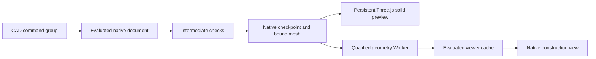

# CAD construction in the Atelier

## Delivery scope

The Atelier follows accepted construction checkpoints in two compact modes.
The solid view shows the developing geometry. The construction view additionally
shows sketches, reference planes and construction elements. A separate action
opens the full SolidCraft interface in the main workspace.

The conversation owns the execution, document, revisions and evidence. Published
delivery checks remain attached to the exact verified source hash.

## Milestones

1. Persist the working presentation identity before broadcasting progress.
   Resolve its native artifact through the accepted checkpoint chain and enforce
   conversation ownership and artifact hashes on every read.
2. Present accepted checkpoints during real CAD brain construction. Preserve the
   camera and responsiveness while preparing the next geometry in a worker.
   Coalesce superseded presentation requests and reject stale completions.
3. Provide solid and construction preview modes, plus the full editor action.
   Keep one document identity across these surfaces and retain exclusive editing
   ownership during agent construction.
4. Restore the conversation's CAD runs and Atelier after server restart. Expose
   CAD checks and retained attempts through Evidence. Qualify this through the
   normal application entry point.

## Current implementation evidence

The first increment records `working-state.json` under the owned document before
progress reaches subscribers. It carries the execution context and presentation
state. Accepted checkpoint resolution validates the engine and contract lineage
and verifies observation hashes. The working artifact endpoint requires the
explicit current checkpoint and uses the existing owned-artifact reader.

The native session exports a presentation mesh while the accepted geometry is
already evaluated. The checkpoint records its hash, size and native source hash.
The solid preview reads that mesh through the conversation-owned artifact route.
A persistent Three.js viewport replaces the geometry and retains the camera,
world origin and GPU resources. Removing the final solid clears the viewport.
Published deliveries select their independently inspected published export.

Construction mode uses the qualified worker and retained native viewport to show
sketches and dimensions. Earlier checkpoints whose records contain no mesh use
the worker fallback for their solid view. Native chrome stays cropped during
view changes and appears when the full editor opens. Worker preparation remains
serialized and coalesces superseded checkpoints.

The 3D preview has separate recenter and fullscreen controls. Fullscreen contains
the model viewport and its navigation controls. SolidCraft Web expands the Atelier
and opens the interactive editor. The existing browser execution bridge controls
ownership, saves and reconnection. Hosted saves serialize the open native session.
Hosted mode delegates file persistence to BigBrain. Asset URLs include the
qualified build identity, and hosted HTML delegates update selection to BigBrain.

Live progress follows accepted command groups. Each group can contain several CAD
operations. A mesh replacement preserves camera state and the document origin.
The viewport tests cover repeated updates, malformed input, removal of the last
solid, graphics context loss and restoration, and resource disposal. Geometric
interpolation between changing topologies remains a later presentation extension.

The capability response exposes editor availability and worker preview
availability independently. A configuration diagnostic identifies a missing
qualified worker distribution. Mesh preparation errors reach the preview footer.
The existing displayed geometry remains available when a replacement is rejected.

CAD model decisions now retain a transport trace ID and duration. Inference
records identify the document, checkpoint and decision. Successful native tool
observations include their elapsed duration. The global CAD execution deadline
reports its phase and accepted checkpoint count through the normal failure and
recovery path.

Each run has a retained presentation record. Conversation history supplements
the bus journal from these records and marks pre-restart work interrupted.
Terminal CAD outcomes publish immutable manifests into the common evidence
repository with their source hashes and measured criteria.

The preview host remains mounted across overview, part and full observation
surfaces. Its camera and compact mode survive these transitions. CAD overview
widgets use one full-width column, with verification following the model.
CAD navigation exposes one primary Piece tab and a Verification tab when checks
are available. Previously retained CAD and overview routes resolve to the same
piece presentation. Preview mode selection stays visible in compact and expanded
layouts, including a return from the full observation shell.

## Qualification

The normal web application was exercised with an artificial constrained plate
and recorded provider decisions. CadBrain executed four native groups, including
the hole sketch and through cut. The browser displayed the third accepted group
while construction was still running, including the sketch and driving dimensions.
The resulting delivery passed its envelope, cut-safety and design-quality checks.
This campaign exercised transport and presentation with recorded decisions.
Model interpretation quality remains covered by the earlier CAD qualification.

After the server process ended, a new process opened the same retained stores.
The conversation reopened its Atelier and the Evidence page displayed the CAD
run and checks. Switching overview, part and full observation preserved the same
native iframe identity. The selected Construction mode survived the round trip.
DOM measurements confirmed equal model/verification widths and a verification
card below the model. Browser screenshots are retained locally under
`/tmp/cad-live-intermediate.png`, `/tmp/cad-live-construction-after-restart.png`
and `/tmp/cad-atelier-stacked-verification.png`.

The preview controls were subsequently exercised through the normal Atelier.
The 3D viewport entered fullscreen, recentered and returned to the page. The
interactive native editor opened its Create Sketch tool and saved working
revision 1 through BigBrain. Browser screenshots are retained locally at
`/tmp/cad-three-fullscreen.png` and `/tmp/cad-editor-integrated.png`.

The frontend suite passes 203 tests across 25 files and its production build
completes. The aggregate CAD, front-decision, model-role, conversation and trace
suite records 506 passing cases and three native qualification failures. The
same results were obtained with the configured isolated 0.28.0 executable used
by the server and with the PATH installation. The section/metrology/workflow/
integration/recovery subset passes 74 tests.

The normal-server drawing 42 candidate reached 26 accepted construction groups.
Revision 10 passed all 66 piece checks and the delivery gate. The inspection
recipe was reused after validating its construction identity. The replay added
zero model calls. After a complete server stop and restart, the normal interface
retained the piece, exports, verified status, seven historical attempts and
recorded evidence. A second retained drawing is being qualified through the same
interface. Final aggregate regression remains pending.

| Native case | Observed failure |
| --- | --- |
| Quarter-bend pipe/flange union | Native union returns no result |
| Flush cutting tool at 60° | Native pipe cut returns no result |
| Extended cutting tool at 60° | The inlet opening fails the outward material boundary check |

The parameterized coil case passes in both latest aggregate runs. An earlier
campaign recorded a volume discrepancy for that case. These observations remain
associated with their recorded builds and artifacts.

Visual Front Brain intake has a separate 300 s completion window. The drawing 49
retry completed in 128.506 s with 4,932 output tokens, including 75 reported
reasoning tokens. The typed drawing dossier contributes to response latency.
The initial 120 s attempt ended before a valid decision. The second drawing
currently awaits clarification of its R8 underside relief depth.

The full native editor uses its available viewport height without flex shrinkage.
Its ribbon, document browser and native parameter dialog remain inside the
expanded Atelier surface.

## Remaining integration boundaries

The interactive editor opens after the retained run stops. Live previews retain
observation ownership during construction. Manual edits belong to the separate
browser working revision and require geometry checks before publication. The
browser campaign was observed on Linux. Windows execution remains
to be qualified against the shared behavior and storage contracts.

The existing hosted viewer and worker changes are prerequisites already present
in this worktree. The completed branch will receive one final push. Merge follows
the repository owner's subsequent review.
